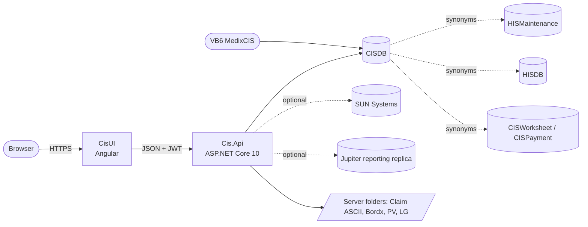

# CIS — VB6 to ASP.NET Core + Angular migration

This repository migrates **MedixCIS**, the VB6 desktop Claims & Invoicing System (`CIS VB/medixcis.vbp`), to a browser application:

- **`Cis/`**: an ASP.NET Core 10 Web API.
- **`CisUI/`**: an Angular 22 front end.

The new application keeps the desktop's functionality, business rules, messages and permissions. It works on the **same SQL Server
databases** (the GENESIS / HIS / CIS databases), so the desktop and the web application can run side by side during the change-over.

| | |
|---|---|
| Status | Phases 0–10 done. 107 of 110 menu screens are migrated; the other 3 are blocked (see [Not migrated](#not-migrated)). Phase 11 (finish) remains. |
| Backend | .NET 10, ASP.NET Core Web API, Dapper, FluentValidation, Serilog, JWT, Swagger |
| Front end | Angular 22.2.3 (standalone components, signals, lazy routes), GENESIS look and feel |
| Database | SQL Server; existing schemas untouched, only an additive `cis` schema (procedures and synonyms) in CISDB |
| Tests | 330 backend tests (xUnit), 21 UI unit tests (Vitest), 111 browser checks (Puppeteer) |
| Plan | [Cis/docs/migration-plan.md](Cis/docs/migration-plan.md) ([HTML](Cis/docs/migration-plan.html)) |

---

## Contents

1. [Repository layout](#repository-layout)
2. [Architecture](#architecture)
3. [Prerequisites](#prerequisites)
4. [Getting started](#getting-started)
5. [Configuration](#configuration)
6. [Testing](#testing)
7. [Migration rules](#migration-rules)
8. [Modules and screens](#modules-and-screens)
9. [Tracking and report engines](#tracking-and-report-engines)
10. [Not migrated](#not-migrated)
11. [Running the legacy VB6 application](#running-the-legacy-vb6-application)
12. [Documentation index](#documentation-index)
13. [Conventions](#conventions)

---

## Repository layout

```
CIS/
├── CIS VB/                  Original VB6 source of MedixCIS (untouched reference)
├── LocalRun/                Patched copy of the VB6 app that runs on this PC (setup-localrun.ps1)
├── Cis/                     Web API
│   ├── Cis.sln
│   ├── src/
│   │   ├── Cis.Domain/          entities, business rules, domain errors (no dependencies)
│   │   ├── Cis.Application/     services (use cases), ports, request / response models, validators, report catalogues
│   │   ├── Cis.Infrastructure/  Dapper repositories, SQL sessions, Excel / PDF, e-mail, files
│   │   └── Cis.Api/             controllers, JWT auth, access-right filter, error handling, Swagger
│   ├── tests/Cis.Api.Tests/     unit, service, architecture, integration and database tests
│   ├── sql/
│   │   ├── main/                one script per area (000_setup.sql … 1154_claim_tracking2.sql)
│   │   ├── cis-main.sql         generated: all of main/ in order (the script to deploy)
│   │   └── tools/               generators for the tracking engines and their source procedures
│   └── docs/                    architecture, onboarding, plan, menu mapping, screen docs, test guides
├── CisUI/                   Angular front end
│   ├── src/app/
│   │   ├── core/                session, access rights, HTTP interceptor, guards, notifications, lookups
│   │   ├── shared/              button, field, date input, data grid, tabs, modal, page shell, helpers
│   │   ├── layout/              top bar, rail, side bar, menu.ts (the full desktop menu with status)
│   │   ├── pages/               login, home, module overview
│   │   └── features/            one folder per module (maintenance, membership, invoice, …, reports)
│   ├── e2e/                     Puppeteer browser checks (run.mjs, only.mjs, steps/*.mjs)
│   └── scripts/                 menu-mapping.mjs, test-guide-coverage.cjs
└── AGENTS.md                Working notes for developers and coding agents (commands, local setup)
```

## Architecture



- **Clean Architecture** in four projects: `Cis.Domain` ← `Cis.Application` ← `Cis.Infrastructure` ← `Cis.Api`. The architecture tests
  enforce these references.
- **One connection per request** (CISDB). The other databases are reached through `cis.*` synonyms, so a save that touches several
  databases is **one transaction**. The desktop used up to eight connections and no transactions.
- **No dynamic SQL from the client.** The desktop pasted typed text into SQL (`@StrAppend`). Here each legacy procedure is reproduced as a
  parameterised `cis.*` procedure, which also removes the desktop's SQL injection.
- **Stateless API.** Identity travels in a JWT carrying the user's desktop access string (`USR.USRAccess`). Every endpoint has
  `[RequireAccess(n)]`, and the UI has a matching route guard.
- **Outputs.** Excel files use ClosedXML, PDFs use PDFsharp-MigraDoc 6.2.x, and e-mail uses MailKit (a pickup folder in development).
  Files the desktop wrote to network shares are offered as browser downloads.
- **Production.** The API serves the Angular build from `wwwroot`, so it is a single deployable. In development `ng serve` proxies `/api`
  to the API.

Details: [Cis/docs/architecture.md](Cis/docs/architecture.md).

## Prerequisites

| Tool | Version |
|---|---|
| .NET SDK | 10 |
| Node.js | ≥ 22.22.3 (Angular 22) |
| SQL Server | instance with the restored GENESIS databases: HISDB, HISDMArchive, HISWorkSheet, HISPayment, HISMaintenance, CISDB, CISWorksheet, CISPayment |
| sqlcmd | for deploying the SQL scripts (run from PowerShell) |
| Chrome | for the browser checks (Puppeteer uses the installed Chrome) |

Locally the databases are on the default instance `localhost`, with Windows authentication. TCP is off, so connection strings use
`(local)`.

## Getting started

### 1. Deploy the database objects (once, and after any change under `Cis/sql/main`)

```powershell
sqlcmd -S localhost -E -d CISDB -i Cis\sql\cis-main.sql
```

This is additive only. It creates the `cis` schema, the synonyms and the procedures, and changes no existing tables or data. It is safe to
run again.

### 2. Start the API (http://localhost:5100, Swagger at `/swagger`, health at `/api/health`)

```powershell
cd Cis\src\Cis.Api
$env:Auth__JwtKey = '<any secret of 32+ characters>'
dotnet run --launch-profile http
```

### 3. Start the UI (http://localhost:4200)

```powershell
cd CisUI
npm ci
npm start        # ng serve; proxies /api to :5100
```

Log in with a `HISMaintenance.dbo.USR` account (the same accounts as the desktop). Each successful login is recorded in the same way as
on the desktop: `CIScnt`, `Tbl_USRTrack` and the optional login log file.

Step-by-step guide: [Cis/docs/onboarding.md](Cis/docs/onboarding.md).

## Configuration

`Cis/src/Cis.Api/appsettings.json` (override with environment variables, for example `Auth__JwtKey`):

| Key | Purpose |
|---|---|
| `ConnectionStrings:CisDb` | CISDB; every other database is reached through synonyms |
| `ConnectionStrings:Reporting` | Jupiter / Neptune replica for the "(Jupiter)" screens; empty = CisDb |
| `ConnectionStrings:SunSystems` | SUN Systems accounting database (A/C Export > SUN screens); empty = those screens answer "not configured" |
| `Auth:JwtKey`, `Auth:TokenHours` | token signing key and lifetime |
| `Session:LoginLogPath` | optional login log file (the desktop's `LoginCIS.txt`) |
| `Email:Host`, `Port`, `UseTls`, `From`, `PickupDirectory` | SMTP settings for the e-mail notification screens; development writes e-mails to `LocalRun\MailPickup` and sends nothing |
| `Reports:TemplateRoot`, `Reports:MaxRows` | folder of the report templates; row cap for large listings |
| `Cors:Origins` | allowed browser origins when the UI is not served by the API |

Production checklist (open items):

- **SMTP:** set the SMTP server, then confirm the BCC addresses copied from the desktop. Rejection uses `foo@medix.com.my`, which looks
  like a placeholder.
- **Output folders:** set the server folders for generated files.
- **SUN Systems:** set the SUN Systems connection if it becomes available.

## Testing

```powershell
# Backend: unit, architecture, integration; the database tests run when CIS_TEST_DB is set (they roll back their changes)
$env:CIS_TEST_DB = 'Server=(local);Database=CISDB;Integrated Security=true;Encrypt=false;TrustServerCertificate=true;Connect Timeout=60'
dotnet test Cis\Cis.sln

# After editing Cis/sql/main/*.sql: rebuild the combined script, then redeploy it
$env:CIS_WRITE_SQL = '1'; dotnet test Cis\Cis.sln --filter Combined_script_is_up_to_date

# Front end
cd CisUI
npm run lint     # oxlint
npm test         # Vitest
npm run build    # production build

# Browser checks (API and UI running; performs a real login)
$env:E2E_PASSWORD = '<password of the local test account>'
npm run e2e                                         # every module
$env:E2E_STEPS = 'reports'; node e2e/only.mjs       # one module (steps in e2e/steps)
```

**Manual test guides.** There is one guide per module in [Cis/docs/testing](Cis/docs/testing). Each lists the steps, real local test
data, the exact desktop messages, and clean-up SQL for anything that writes. Every migrated screen has a section; to check:

```powershell
cd CisUI; node scripts/test-guide-coverage.cjs
```

## Migration rules

1. **Same behaviour as the desktop form:** the same functionality, logic, validations, messages, permissions and database updates.
2. **Database schema untouched:** only `cis.*` objects are added.
3. **Desktop bugs are reproduced and recorded** in the screen doc under "Known desktop issues".
4. **Exceptions are recorded too.** The only deliberate fixes are security problems and features that could not work (for example
   queries that always failed). They are listed under "Deliberate differences" / "Fixed desktop bugs".
5. **Large report-engine forms keep every report choice.** They are not simplified to one screen. Their queries are generated from the
   desktop procedures and checked row-for-row against them.
6. **Every screen has a doc, tests and a test-guide section.** The doc is in `Cis/docs/screens`. The tests are backend tests plus a
   browser check where possible.

## Modules and screens

Status per menu item: [Cis/docs/menu-mapping.md](Cis/docs/menu-mapping.md), generated from `CisUI/src/app/layout/menu.ts` with
`node scripts/menu-mapping.mjs`.

| Phase | Module | Main screens | Docs / tests |
|---|---|---|---|
| 0 | Foundation | Login, logout, change password, layout with the full CIS menu, shared components, lookups | [frmLogin](Cis/docs/screens/frmLogin.md) |
| 1 | Maintenance | Entity, Plan, Case, Calculation, LG maintenance, Benefits (member / clinic / clinic new / dental), code tables, list reports | [screens](Cis/docs/screens/maintenance-code-tables.md) · [tests](Cis/docs/testing/maintenance-test-guide.md) |
| 2 | Membership | MBM adjustment, enquiry, top-up, general exclusions enquiry, case transfer, clinic member registration | [screens](Cis/docs/screens/membership.md) · [tests](Cis/docs/testing/membership-test-guide.md) |
| 3 | Invoice | Worksheet calculation engine, clinic / member invoice, adjustments, enquiry, OP batch, pass to claim | [screens](Cis/docs/screens/invoice.md) · [tests](Cis/docs/testing/invoice-test-guide.md) |
| 4 | LG & Audit | Generate LG (PDF letters), audit review, audit tracking | [screens](Cis/docs/screens/lg-audit.md) · [tests](Cis/docs/testing/lg-audit-test-guide.md) |
| 5 | MCO Fees | MCO invoice, GST, GST zeroised, fee listing, refund listing | [screens](Cis/docs/screens/mco-fees.md) · [tests](Cis/docs/testing/mco-fees-test-guide.md) |
| 6 | Claim Bordx | Insert worksheet / invoice, remove, bordx date, delivery, monitoring, Print Bordx with the client variants, BSN summary | [screens](Cis/docs/screens/claim-bordx.md) · [tests](Cis/docs/testing/claim-bordx-test-guide.md) |
| 7 | Payment | To clinic, clinic invoice, to member, FFS, pay clinic post, payment tracking | [screens](Cis/docs/screens/payment.md) · [tests](Cis/docs/testing/payment-test-guide.md) |
| 8 | Receipt | Fr member, Fr group company, Fr FFS, Fr MNRB, uploads | [screens](Cis/docs/screens/receipt.md) · [tests](Cis/docs/testing/receipt-test-guide.md) |
| 9 | A/C Export | Invoice, payment, bordx and receipt postings (SUN posting files) | [screens](Cis/docs/screens/ac-export.md) · [tests](Cis/docs/testing/ac-export-test-guide.md) |
| 10 | Tracking & reports | MBM tracking ×4, Claim tracking ×7, invoice tracking ×2, clinic tracking ×2, Claim ASCII exports ×7, OMNI med providers, e-mail notifications ×3 | [screens](Cis/docs/screens/reports.md) · [tests](Cis/docs/testing/reports-test-guide.md) |
| 11 | Finish | Performance pass, security review, publish script | pending |

## Tracking and report engines

MBM Tracking and Claim Tracking are report engines. The desktop forms have 70–100+ report choices each, built from procedures with 40–178
query cases. They are migrated by generation, not by hand:

1. `Cis/sql/tools/gen-trk.js <engine>` reads the desktop procedure and generates a parameterised `cis.*_Run` procedure. The engines are
   `mbm`, `mbmsimple`, `claim`, `claimsimple` and `claim2`. Each case keeps its original SELECT and grouping, and the typed criteria
   become parameters (`build-*-filters.js`).
2. Analyser scripts read the VB6 form and produce a JSON **report catalogue** for each form variant: report type and choice, query case,
   columns, formats and desktop headers. The scripts are `analyse-mbmtrk*.js` with `gen-mbm-all.sh`, `analyse-clmtrk.js` and
   `analyse-ct2.js`. The catalogues are embedded in `Cis.Application/Reports`.
3. Reports that combine several queries or calculate values are ported by hand. They are in `MbmTrackingSummaries.cs` and
   `ClmTrackingSpecials.cs`.
4. One Angular page per engine serves all of its variants, picked by route data: main, Simple, Jupiter, Jupiter-Simple and SUN.

The generated SQL uses single-quoted values. Several desktop procedures used double-quoted values, which fail under QUOTED_IDENTIFIER
ON. `CISClaimTracking2` fails on the desktop for that reason; the migrated Claim Tracking 2 works.

## Not migrated

| Item | Status | Reason |
|---|---|---|
| General Exclusions (frmGeneralBenefitExclusion) | Blocked | The desktop menu opens a form that is missing from the source and the project. Needs the form or its rules. The read-only enquiry is migrated. |
| Worksheet Registration / Adjustment (frmNewWSReg / frmNewWSAjd) | Blocked | Never opened by the desktop, and they need worksheet tables and views that the current databases no longer have. |
| SUN System GST / Report / Allocation / Allocation (New) | Nothing to build for now | They need the SUN Systems database, which is not available. They can be built if it is provided. |
| MBM Tracking (old), Claims Data, Sin Chew Excel, Pay Member Post, Test Form | Nothing to build | An older copy that is never opened, forms without code, or a developer test form. |
| Invoice Control, Dental ×3, To Member - Batch, DataTransfer | Nothing to build | Menu items with no handler and no form. |

The full list with reasons is in [Cis/docs/menu-mapping.md](Cis/docs/menu-mapping.md).

## Running the legacy VB6 application

`CIS VB/` is the untouched original. `LocalRun/setup-localrun.ps1` creates a patched copy in `LocalRun/Src` that runs on a PC without
Crystal Reports or Outlook. The copy has local paths and UDL connections to the eight databases. Start it from PowerShell, without
elevation:

```powershell
$env:__COMPAT_LAYER = 'RunAsInvoker'
& 'C:\Program Files (x86)\Microsoft Visual Studio\VB98\VB6.EXE' /run "D:\CIS\LocalRun\Src\medixcis_local.vbp"
```

Crystal report screens and the Outlook e-mail screens fail in this copy, by design. Details are in [AGENTS.md](AGENTS.md).

## Documentation index

| Document | Content |
|---|---|
| [Cis/docs/migration-plan.md](Cis/docs/migration-plan.md) | Decisions, inventory, phases, risks, open questions |
| [Cis/docs/architecture.md](Cis/docs/architecture.md) | System context, layers, data access, security, outputs |
| [Cis/docs/onboarding.md](Cis/docs/onboarding.md) | Running everything locally; configuration reference |
| [Cis/docs/menu-mapping.md](Cis/docs/menu-mapping.md) | Every desktop menu item: form, access right, phase, status, web route |
| [Cis/docs/screens/](Cis/docs/screens) | Per-screen behaviour, messages, known desktop issues, deliberate differences |
| [Cis/docs/testing/](Cis/docs/testing) | Manual test guides with local data and clean-up SQL |
| [Cis/sql/README.md](Cis/sql/README.md) | SQL scripts and how they are deployed |
| [CisUI/e2e/README.md](CisUI/e2e/README.md) | Browser checks |
| [AGENTS.md](AGENTS.md) | Commands, local environment notes, generators |

## Conventions

- **Dependencies:** pinned exactly. npm uses `save-exact` with versions at least 7 days old. PDFsharp-MigraDoc stays on 6.2.x, because
  6.5+ is AGPL.
- **Generated files:** after changing `menu.ts`, regenerate the menu mapping. After changing `sql/main`, regenerate `cis-main.sql`.
- **Commit messages:** a short summary line, then the reason for the change.
- **Branches:** the remote is `github.com/vnaatla/CIS`. Work is committed locally and pushed on request.
